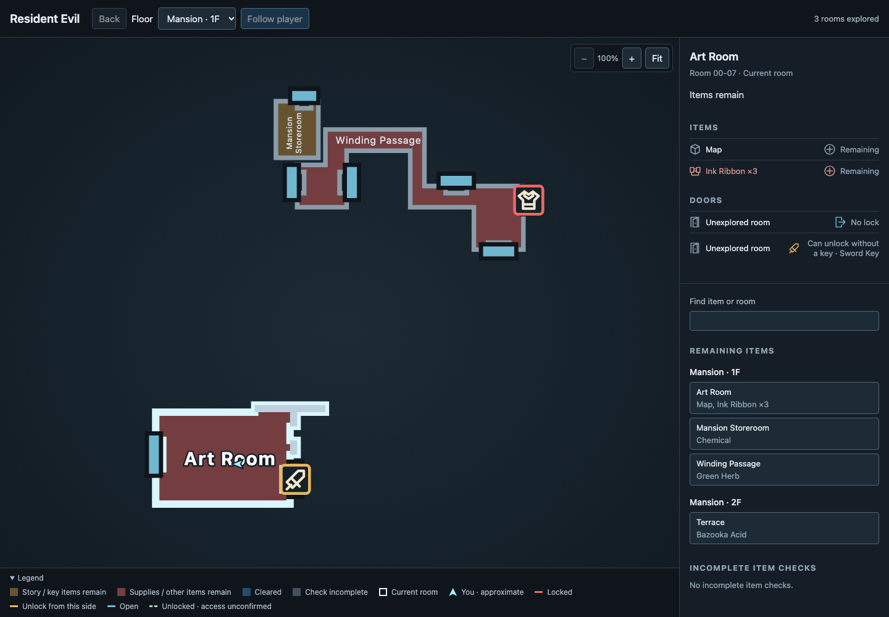
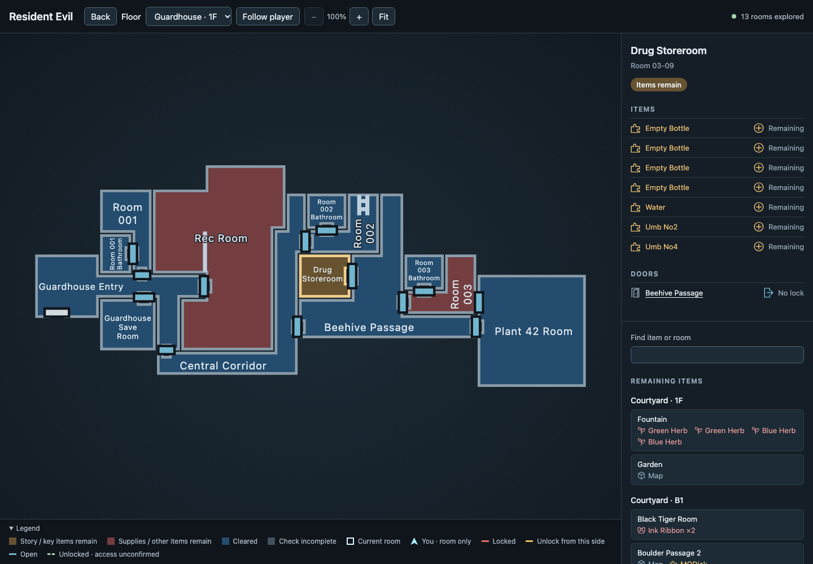

# re-map

A live map for the PS1 Resident Evil games in DuckStation. It reads game memory through DuckStation's built-in GDB server and draws the rooms you've entered, the items still in them and which doors are locked. Nothing on the disc is modified.



## Supported games

Each profile targets one exact disc. Other regions and revisions won't work.

| Game | Disc | Mode | Profile |
| --- | --- | --- | --- |
| Resident Evil Director's Cut | USA, SLUS-00551 | Jill | default |
| Resident Evil 2 Dual Shock Ver. | USA Disc 1, SLUS-00748 | Leon A, Original Game, Normal | `profiles/re2_leon_a_slus00748.json` |
| Resident Evil 2 Dual Shock Ver. | USA Disc 2, SLUS-00756 | Claire B, Original Game, Normal | `profiles/re2_claire_b_slus00756.json` |
| Resident Evil 3: Nemesis | USA, SLUS-00923 | Jill, Hard | `profiles/re3_jill_hard_slus00923.json` |

RE1 is the most tested. RE2 and RE3 work but have seen less real play; the [RE2](docs/re2.md) and [RE3](docs/re3.md) guides list what has been checked. Use DuckStation savestates to save and load. Memory-card saves aren't covered.

## Setup

You need Python 3, DuckStation, your own BIOS and your own disc.

Close DuckStation and add this to its `settings.ini`:

```ini
[Debug]
EnableGDBServer = true
GDBServerPort = 2345
```

Turn RetroAchievements off or use Casual/Softcore mode. Hardcore mode blocks the GDB connection and savestates.

## Run it

1. Start the game in DuckStation, or load a savestate.
2. From the project folder, start the tracker:

   ```sh
   python3 tools/track.py --map
   ```

3. Open <http://127.0.0.1:8765/>. If another program already uses that port, pick a free one with `--map-port` and open that port instead.

Leave the terminal open while you play. Ctrl+C stops the tracker.

## Examples

Track RE2 as Leon:

```sh
python3 tools/track.py --profile profiles/re2_leon_a_slus00748.json --map
```

Track RE3. The tracker reads room scripts from your disc image, so pass its CUE file:

```sh
python3 tools/track.py --profile profiles/re3_jill_hard_slus00923.json \
  --disc "$HOME/Games/DuckStation/Resident Evil 3 - Nemesis.cue" --map
```

Start over with an empty map. This replaces the saved exploration for that game:

```sh
python3 tools/track.py --map --new-playthrough
```

Keep a second RE1 run without touching the first one's map:

```sh
python3 tools/track.py --map --history-file .local/re1-knife-run.json
```

Check that the tracker can read the game, without starting the map. It prints one snapshot of the current room and exits:

```sh
python3 tools/track.py --once
```

Use a different GDB port. It has to match `GDBServerPort` in `settings.ini`:

```sh
python3 tools/track.py --map --port 2346
```

## Reading the map

A room shows up once you walk into it. Picking up the in-game map doesn't reveal anything.

| Room fill | Meaning |
| --- | --- |
| Gold | Story or key items remain |
| Red | Only supplies remain |
| Blue | Cleared |
| Gray | The tracker can't tell yet |

The current room has a white outline. In RE1 and RE2 a cyan arrow shows where you are and which way you're facing. The position is approximate because the original maps don't keep room proportions.

Puzzle rewards keep a room gold until you pick them up, even before the puzzle is solved. Files, enemies and doors don't count. The full rules are in [room completion](docs/room-completion.md).

Door colors show whether a door is open. A lock that needs a specific key gets that key's symbol: sword, armor, shield and helmet in RE1, spade, diamond, heart and club in RE2. The symbol goes away once the door is unlocked, and comes back if you load a savestate from before. In RE2, a green open padlock marks a fresh unlock, a dashed frame means access isn't confirmed yet and a red frame means the door is inactive.

Click a room for its item and door list. A check mark means collected, a question mark means unresolved. A count other than one appears after the item name, such as `×15`. Underlined door destinations jump to that room.



## Controls

Scroll or pinch to zoom, drag to pan. **Fit** shows the whole floor, **Floor** switches between explored floors, **Follow player** jumps back to your current room and **Back** returns to the last room you inspected.

The sidebar has **Remaining items** for every explored room and **Find item or room** to search them. Keyboard shortcuts and the rest are in [map controls](docs/map-controls.md).

## Saved exploration

Explored rooms are saved in `.local/`, one file per game and scenario. They stay revealed across tracker restarts and when you load an older savestate. Items and doors always come from the game currently loaded, so loading an earlier save puts picked-up items back on the map.

## Something broke?

Describe what happened and attach `logs/tracker.log`.

## More docs

See the [documentation index](docs/README.md) for research notes, testing and emulator setup.
