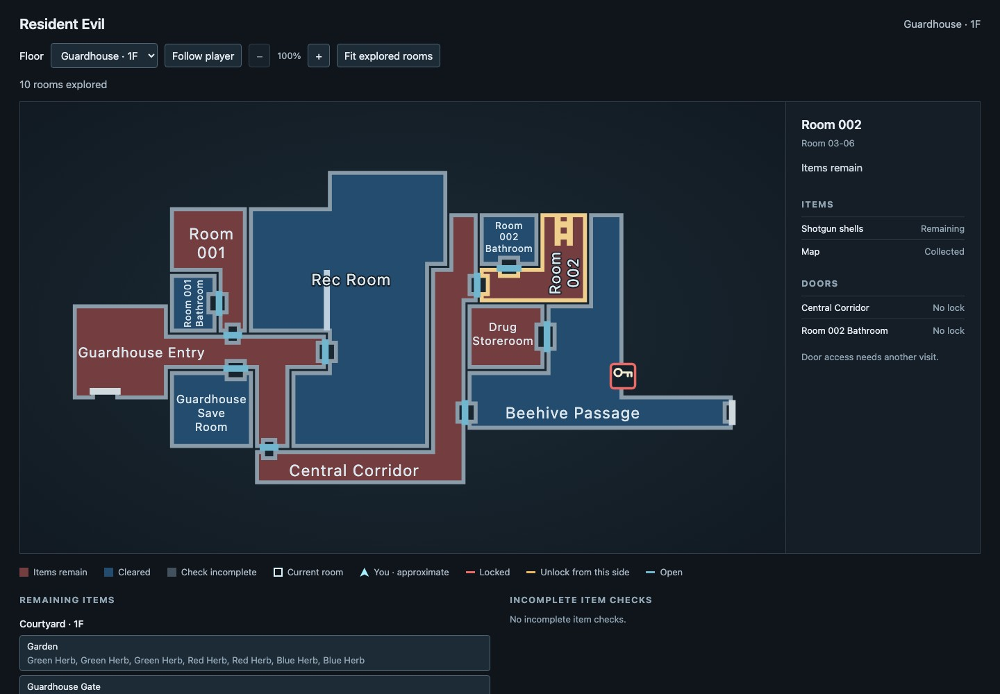
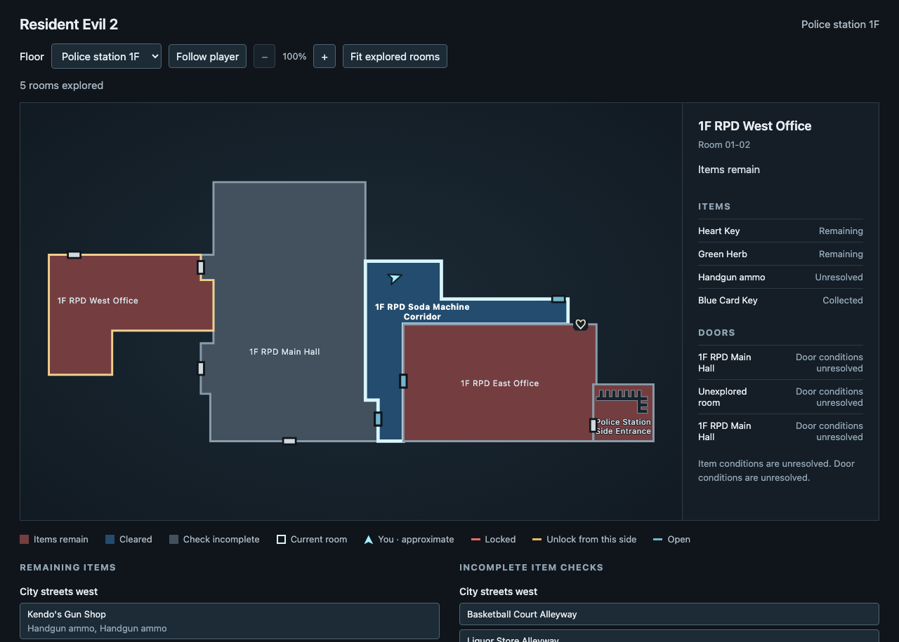

# re-map

A companion map for Resident Evil in DuckStation, showing explored rooms, remaining items and doors.



## Setup

You need Python 3, DuckStation, your own BIOS and Resident Evil Director's Cut USA, SLUS-00551. Supports Jill using DuckStation savestates. The [RE2 Leon A profile](docs/re2.md) targets Dual Shock Ver. USA Disc 1, SLUS-00748, in Original mode on Normal difficulty. Its gameplay validation is still limited.

With DuckStation closed, add or update these settings in its `settings.ini`:

```ini
[Debug]
EnableGDBServer = true
GDBServerPort = 2345
```

The GDB server is built into DuckStation. You do not need to install or start a separate debugger.

## Play

1. Open DuckStation and start Jill's game or load a compatible savestate.
2. From the project folder, run:

   ```sh
   python3 tools/track.py --map
   ```

3. Open [the tracker map](http://127.0.0.1:8765/) in your browser.

Keep the terminal running while you play. Press Ctrl+C there to stop the tracker.

Rooms appear as you enter them. Gold means story/key items remain; red means supplies or other items remain; blue means cleared; gray means the item check is incomplete. Story/key items determine the color when both kinds remain. RE1 puzzle rewards keep their room incomplete until collected, even before the puzzle is solved. In RE1 and RE2, the cyan arrow follows your approximate position where placement is established and rotates with your facing direction. Placement is approximate because the original maps distort room proportions. The legend identifies approximate placement or a room-only marker when position is unavailable. The white outline also marks the current room. Click a room to see its items and doors.

The item list uses gold symbols for story/key items and red symbols for supplies, alongside their names and status text. Verified item counts other than one appear beside item names, including in **Remaining items**. Weapon resources, key uses and unresolved amounts have no multiplier. Check marks, question marks and door/key symbols distinguish collection and access states. An unresolved item identity uses a neutral collectible symbol.

Stair treads, rails and ladders appear inside explored room outlines.

Door colors show access. Key symbols identify Sword, Armor, Shield and Helmet locks; hover for the key's name. A symbol disappears once its door is unlocked and returns if an earlier savestate restores the lock. The RE2 profile uses suit symbols for Spade, Diamond, Heart and Club locks. Other named keys use a key symbol.

In RE2, a green open padlock shows a freshly confirmed unlock. A dashed frame means access is still unconfirmed; a red frame means the door is inactive. Unlock knowledge stays separate from being able to pass through the door now.

Use **Floor** to browse explored floors. Click **Follow player** to stop inspecting a selected room and resume selecting each room you enter. The highlighted button shows when following is active.

Use the mouse wheel or **+ / −** buttons to zoom, and drag the map to move it. **Fit explored rooms** shows the whole explored floor again.

Use **Remaining items** to find pickups in explored rooms, and click a room to open it on the map. Off-screen outlines come into view at your chosen zoom, zooming out if needed to fit. **Incomplete item checks** names unresolved items and identifies incomplete item lists, with links to their rooms.

Use **Find item or room** to filter both lists across explored floors. Press Escape in the search field to clear it.

Explored rooms are saved automatically and stay revealed after restarts or earlier savestate loads. Items and doors update to match the loaded game.

For a new playthrough, run `python3 tools/track.py --map --new-playthrough`. Use `--history-file <path>` to keep another playthrough separate.

If something goes wrong, report what happened and include `logs/tracker.log` from the project folder.

## Resident Evil 2

Start Leon A in **Original Game → Normal** on Dual Shock Ver. USA Disc 1, **SLUS-00748**, then run:

```sh
python3 tools/track.py --profile profiles/re2_leon_a_slus00748.json --map
```

For Claire B on Dual Shock Ver. USA Disc 2, **SLUS-00756**:

```sh
python3 tools/track.py --profile profiles/re2_claire_b_slus00756.json --map
```

Each revision and scenario has a separate exploration history. Keep RetroAchievements in Casual/Softcore mode when using the tracker and savestates. The [RE2 guide](docs/re2.md) lists the exact disc identities and validation limits.


