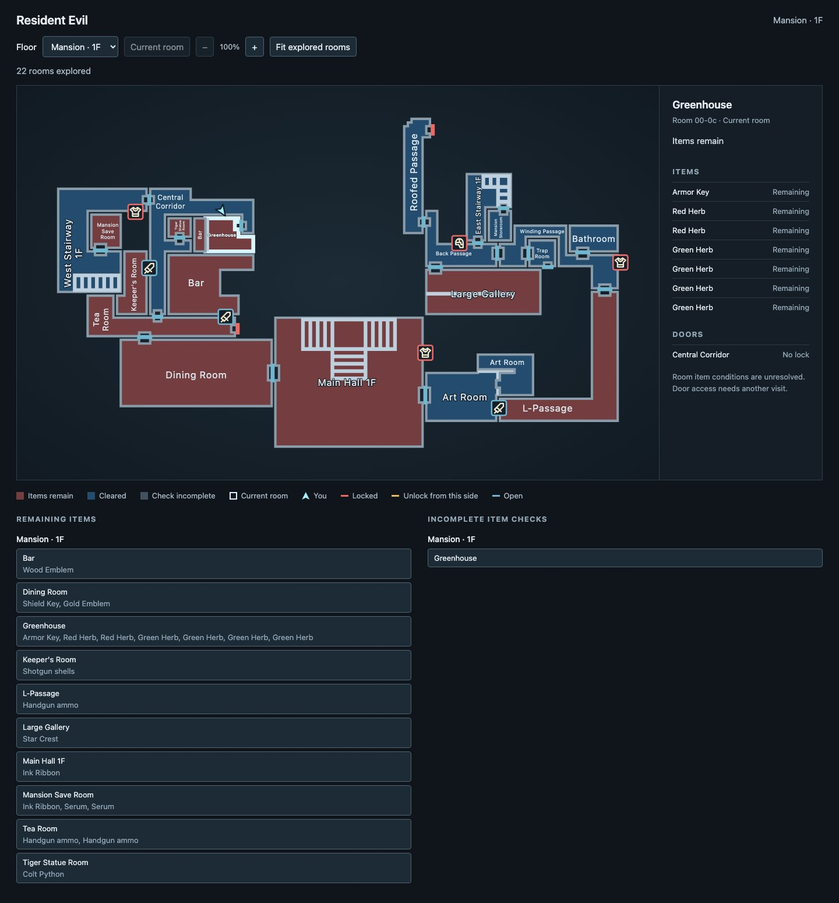

# re-map

A companion map for Resident Evil in DuckStation, showing explored rooms, remaining items and doors.



## Setup

You need Python 3, DuckStation, your own BIOS and Resident Evil Director's Cut USA, SLUS-00551. Supports Jill using DuckStation savestates. An initial [RE2 Leon A profile](docs/re2.md) is also available for USA Disc 1, SLUS-00421. Its gameplay validation is still limited.

With DuckStation closed, add or update these settings in its `settings.ini`:

```ini
[Debug]
EnableGDBServer = true
GDBServerPort = 2345
```

The GDB server is built into DuckStation. You do not need to install or start a separate debugger.

## Play

1. Open DuckStation and start Jill's game or load a compatible savestate.
2. From the project folder, run:

   ```sh
   python3 tools/track.py --map
   ```

3. Open [the tracker map](http://127.0.0.1:8765/) in your browser.

Keep the terminal running while you play. Press Ctrl+C there to stop the tracker.

Rooms appear as you enter them. Red means items remain; blue means cleared; gray means the item check is incomplete. RE1 puzzle rewards keep their room red until collected, even before the puzzle is solved. In RE1 and RE2, the cyan arrow follows your approximate position where placement is established and rotates with your facing direction. Placement is approximate because the original maps distort room proportions. The legend identifies approximate placement or a room-only marker when position is unavailable. The white outline also marks the current room. Click a room to see its items and doors.

Stair treads and rails appear inside explored room outlines.

Door colors show access. Key symbols identify Sword, Armor, Shield and Helmet locks; hover for the key's name. A symbol disappears once its door is unlocked and returns if an earlier savestate restores the lock. The RE2 profile uses suit symbols for Spade, Diamond, Heart and Club locks. Other named keys use a key symbol.

Use **Floor** to browse explored floors. Click **Follow player** to stop inspecting a selected room and resume selecting each room you enter. The highlighted button shows when following is active.

Use the mouse wheel or **+ / −** buttons to zoom, and drag the map to move it. **Fit explored rooms** shows the whole explored floor again.

Use **Remaining items** to find pickups in explored rooms, and click a room to open it on the map. **Incomplete item checks** lists rooms the tracker cannot fully check.

Explored rooms are saved automatically and stay revealed after restarts or earlier savestate loads. Items and doors update to match the loaded game.

For a new playthrough, run `python3 tools/track.py --map --new-playthrough`. Use `--history-file <path>` to keep another playthrough separate.

If something goes wrong, report what happened and include `logs/tracker.log` from the project folder.

## Resident Evil 2

Start Leon A on the pinned USA Disc 1, then run:

```sh
python3 tools/track.py --profile profiles/re2_leon_a_slus00421.json --history-file .local/re2-leon-a.json --map
```

The [RE2 guide](docs/re2.md) lists coverage and unresolved checks. Keep its exploration history separate from Jill's.


